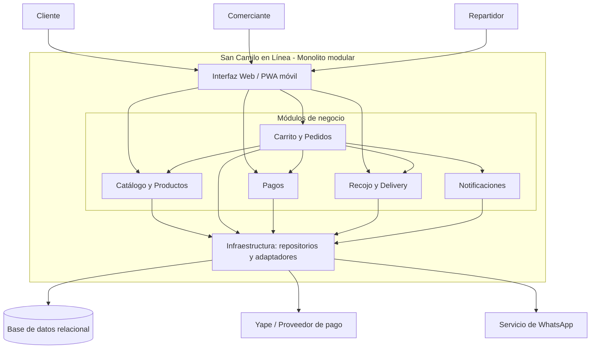
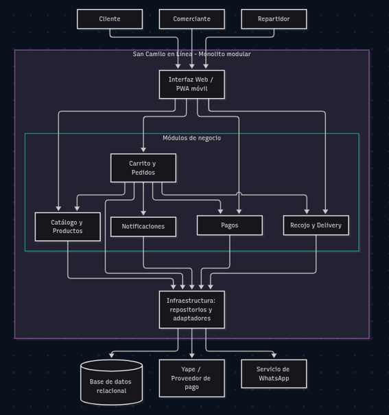
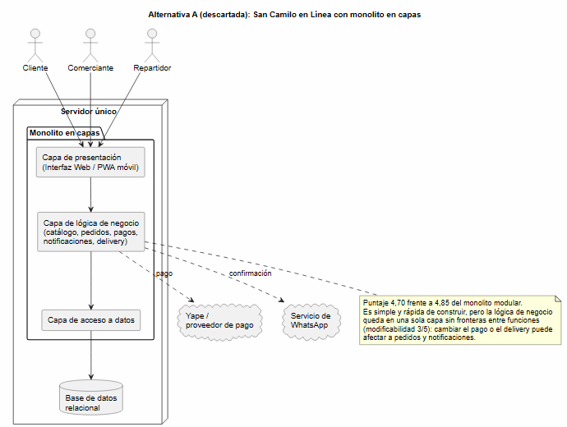
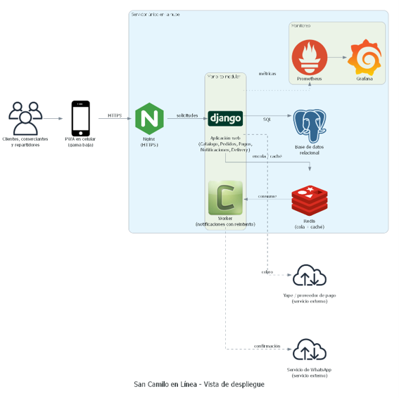
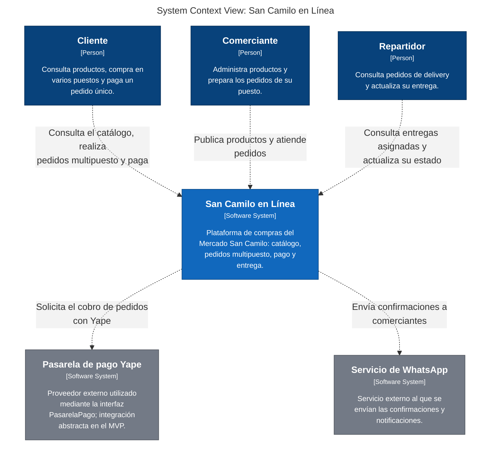

# San Camilo en Línea — Laboratorio 04: Fundamentos de arquitectura de software

Construcción de Software · EPIS-UNSA · 2026-B · Grupo 07

## Integrantes

| Nombre | Rol en el laboratorio |
|--------|-----------------------|
| Flores Nuñez Rodrigo Francisco | Diagramador |
| Jimenez Paredes Fabricio Gabriel | Redactor de drivers |
| Bravo Arredondo Cristhian Matías | Verificador de IA |

## Caso

**San Camilo en Línea** es una plataforma para hacer pedidos a los puestos del Mercado San Camilo, con recojo en el mercado o delivery. Los actores son el cliente, el comerciante y el repartidor.
El MVP incluye un catálogo por puesto, pedidos con productos de varios puestos, pago con Yape y confirmación del pedido al comerciante por WhatsApp.
**Atributo de calidad crítico:** la capacidad de interacción. Un comerciante con poca experiencia digital debe poder publicar un producto en **3 toques o menos desde un celular de gama baja** (QA-01).
Para cumplirlo, elegimos un **monolito modular** ([ADR-001](docs/architecture/001-estilo-arquitectonico.md)) con una **PWA** mobile-first ([ADR-002](docs/architecture/002-pwa-vs-app-nativa.md)).

## Arquitectura elegida



## Decisiones arquitectónicas

- [ADR-001: Adoptar un monolito modular para el MVP](docs/architecture/001-estilo-arquitectonico.md)
- [ADR-002: Usar una PWA en lugar de una app nativa](docs/architecture/002-pwa-vs-app-nativa.md)
- [ADR-003: Enviar las confirmaciones de WhatsApp de forma asíncrona con reintentos](docs/architecture/003-notificaciones-asincronas.md)

## Documentación y diagramas

- [Drivers arquitectónicos y escenarios de calidad (E1)](docs/architecture/drivers.md)
- [Matriz de decisión (E2)](docs/architecture/matriz-decision.md)
- [Diagrama Mermaid de la arquitectura elegida (E3)](diagrams/arquitectura.mmd)
- [Alternativa descartada en PlantUML (E5)](diagrams/alternativa.puml)
- [Vista de despliegue con Python Diagrams (E6)](diagrams/despliegue.py)
- [Bitácora de uso de IA (E7)](docs/architecture/bitacora-ia.md)

## Imágenes de los diagramas

### Arquitectura elegida: monolito modular (E3, Mermaid)



### Alternativa descartada: monolito en capas (E5, PlantUML)



### Vista de despliegue (E6, Python Diagrams)



## Reflexión sobre el uso de la IA

La IA nos ayudó a avanzar más rápido. Con ChatGPT generamos y comparamos alternativas, y le pedimos una crítica adversarial. Gemini nos dio borradores de los ADR, Claude escribió el código de PlantUML y de Python Diagrams, y Claude Code nos ayudó a ordenar la bitácora y este README.
También cometió errores. Asumió infraestructura en AWS aunque nuestra restricción era un VPS. Usó una sintaxis desactualizada de la librería `diagrams`, que daba `AttributeError`. Omitió la nota de descarte del PlantUML aunque se la pedimos.
Además, no aceptamos dar por hecho que Yape tiene una API pública abierta sin verificarlo, así que en la arquitectura dejamos "Yape / proveedor de pago".
Aprendimos a contrastar cada propuesta con nuestras restricciones (plazo de 1 mes, presupuesto bajo, equipo de 3), a ejecutar y validar todo el código generado y a no afirmar capacidades de servicios externos sin documentación oficial.
La IA propone, pero el equipo decide y verifica.

## Arquitectura C4 (Lab 06)

Modelamos la arquitectura de San Camilo en Línea con el modelo C4 en cinco vistas: contexto, contenedores, componentes, dinámica (ConfirmarYPagar) y despliegue.
Todas salen de un solo modelo, [`docs/architecture/c4/workspace.dsl`](docs/architecture/c4/workspace.dsl) (Structurizr DSL). Las exportaciones de `export/` y las imágenes de `img/` se generan desde ese archivo.

### Diagrama de contexto (Mermaid, copiado de `export/Contexto.mmd`)

> Nota: según la Tabla 4 de la guía, GitHub renderiza la sintaxis Mermaid C4 de forma experimental. Structurizr CLI exporta Mermaid como diagrama de flujo (`graph LR`), no con la sintaxis `C4Context`, y sin leyenda. Para ver la notación completa con leyenda, usar las imágenes PNG de abajo.



### Vistas (PNG exportados con C4-PlantUML)

- [Contexto (nivel 1)](docs/architecture/c4/img/Contexto.png)
- [Contenedores (nivel 2)](docs/architecture/c4/img/Contenedores.png)
- [Componentes (nivel 3)](docs/architecture/c4/img/Componentes.png)
- [Dinámica: ConfirmarYPagar](docs/architecture/c4/img/ConfirmarYPagar.png)
- [Despliegue](docs/architecture/c4/img/Despliegue.png)

### Documentos del Lab 06

- [Modelo: `workspace.dsl`](docs/architecture/c4/workspace.dsl)
- [Inventario de elementos (E1)](docs/architecture/c4/inventario.md)
- [Comparaciones (E4 y E6)](docs/architecture/c4/comparacion.md)
- [Revisión C4 con la lista oficial (E7)](docs/architecture/c4/revision-c4.md)
- [Explicación para público no técnico (E7)](docs/architecture/c4/explicacion.md)
- [Bitácora de IA (Lab 06)](docs/architecture/c4/bitacora-ia.md)

## Patrones de diseño (Lab 07)

Refactorizamos el flujo "confirmar y pagar" del Lab 05 desde una versión ingenua ([`src/antes/`](src/antes/)) hacia una versión con patrones GoF ([`src/despues/`](src/despues/)). Cada patrón responde a un olor de [`olores.md`](olores.md) y tiene una prueba. Las decisiones están en el [ADR-005](docs/architecture/005-patrones-de-diseno.md).

```bash
python -m pytest -q            # 18 passed
radon cc -s -a src/antes src/despues
```

### Olor → patrón → prueba

| Olor | Patrón | Código | Prueba |
|---|---|---|---|
| El servicio crea y conoce los SDK concretos (olor 1) | Adapter + Strategy + Factory | `puertos.py`, `adaptadores.py`, `factory.py` | `test_open_closed.py::test_open_closed_agregar_nueva_variante_sin_modificar_servicio` |
| Ciclo de vida de `PedidoPuesto` (máquina de estados del Lab 05) | State | `estados.py`, `dominio.py` | `test_comportamiento.py::test_transicion_estado_invalida_lanza_excepcion` |
| El método principal avisa a mano a los interesados (olor 2) | Observer | `eventos.py` | `test_e4_observer_decorator.py::test_observer_nuevo_suscriptor_no_exige_cambiar_publicador` |
| Registro transversal mezclado con el aviso | Decorator | `decoradores.py` | `test_e4_observer_decorator.py::test_decorator_agrega_registro_sin_modificar_aviso` |
| La salida del LLM no es confiable y el proveedor puede cambiar | Strategy + Adapter + Decorator + Chain of Responsibility | `ia.py` | `test_e5_ia.py` (10 casos: caché, guardrails, proveedor sustituible) |
| Reintentos en un bucle interno (olor 3) | Decorator (pendiente) | `estrategias.py` existe, pero el servicio no lo usa | — |

Patrones rechazados: un framework externo de máquina de estados (propuesto por la IA, olor 4) y Composite (`metricas.md`, sección 3).

### Métricas (radon, detalle en [`metricas.md`](docs/design/patrones/metricas.md))

| Métrica | Antes | Después |
|---|---:|---:|
| CC promedio (radon `-a`) | 3,27 | 1,99 |
| CC máxima (`confirmar_y_pagar`) | 10 (B) | 11 (C) |
| SLOC | 80 | 401 |
| Archivos Python | 2 | 10 |

La complejidad promedio baja, pero el método principal sube de 10 a 11 porque los reintentos siguen dentro de él. El código crece 5 veces. Los patrones se justifican por los cambios previstos (Yape, avisos a varios puestos, IA), no por las métricas.

### Diagramas (PlantUML)

- [Pagos: Strategy + Adapter + Factory](docs/design/patrones/img/pagos.png) ([fuente](docs/design/patrones/pagos.puml))
- [State de `PedidoPuesto`](docs/design/patrones/img/estados.png) ([fuente](docs/design/patrones/estados.puml))
- [Observer + Decorator](docs/design/patrones/img/eventos.png) ([fuente](docs/design/patrones/eventos.puml))
- [IA: Strategy + Adapter + Decorator + Chain of Responsibility](docs/design/patrones/img/ia.png) ([fuente](docs/design/patrones/ia.puml))
- [Diagrama de clases del Lab 05 actualizado](docs/design/img/clases.png) ([fuente](docs/design/clases.puml))
- [Diagrama generado con pyreverse](docs/design/patrones/img/classes_patrones.png) y su [verificación](docs/design/patrones/verificacion-pyreverse.md)

### Documentos del Lab 07

- [Olores y decisiones (E1)](olores.md)
- [Métricas y trade-off (E6)](docs/design/patrones/metricas.md)
- [Bitácora de IA (E7)](docs/design/patrones/bitacora-ia.md)
- [ADR-005: patrones de diseño (E8)](docs/architecture/005-patrones-de-diseno.md)
