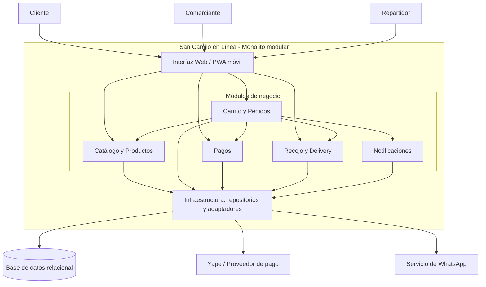
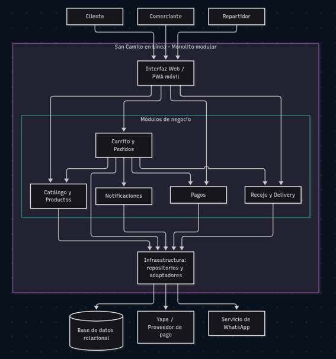
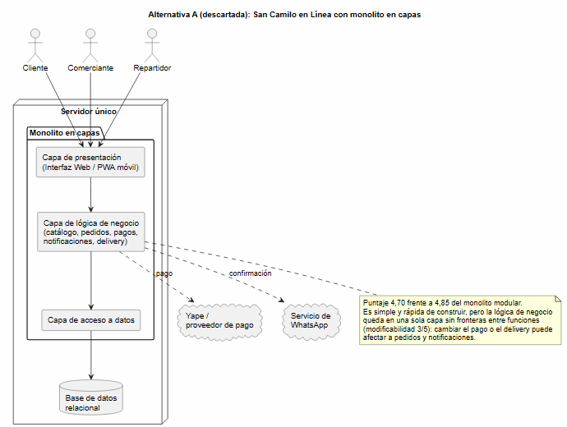
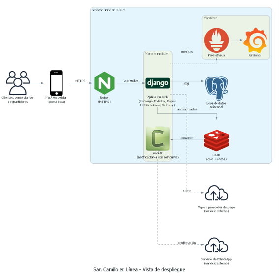
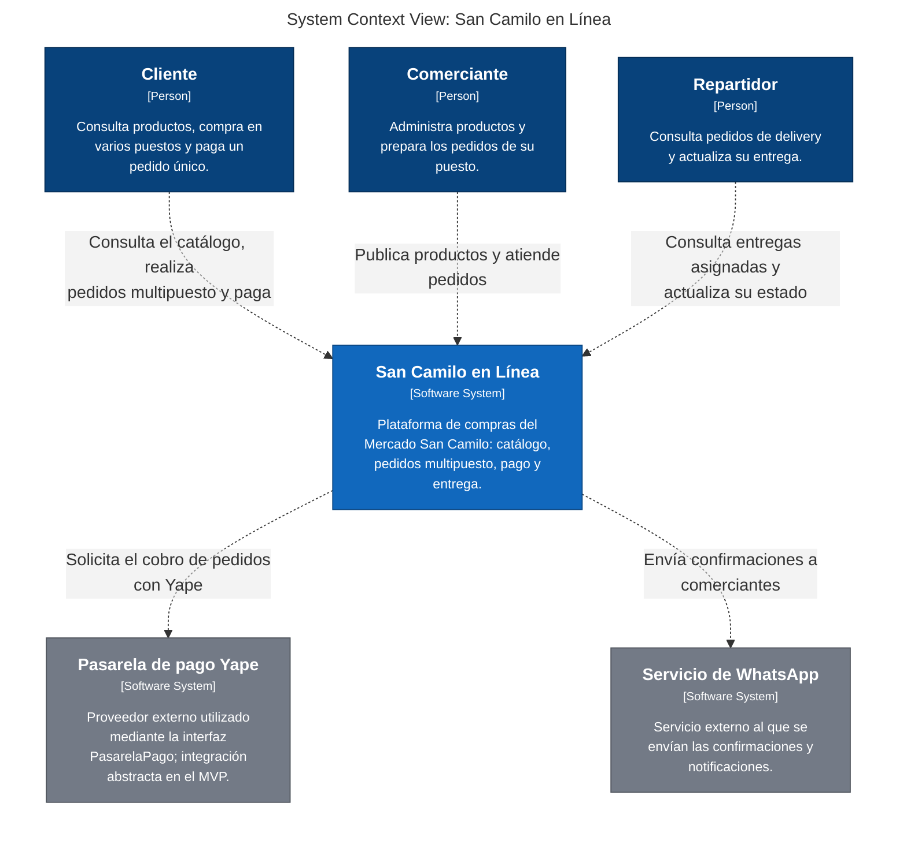
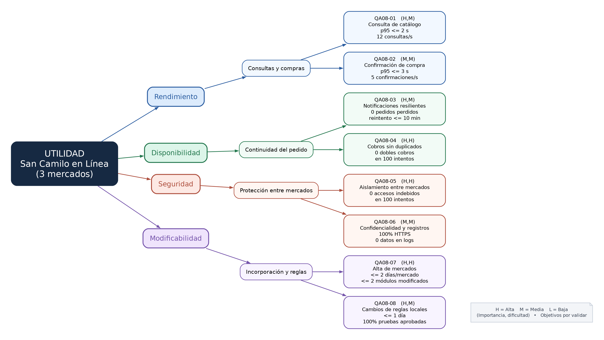
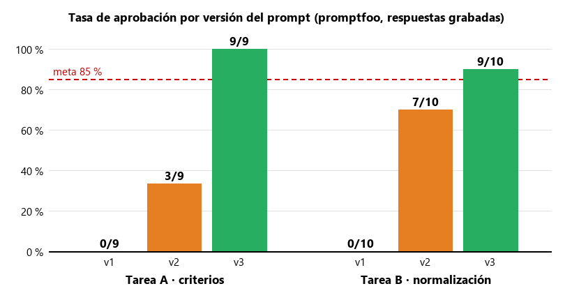

# San Camilo en Línea — Laboratorio 04: Fundamentos de arquitectura de software

Construcción de Software · EPIS-UNSA · 2026-B · Grupo 07

## Integrantes

| Nombre | Rol en el laboratorio |
|--------|-----------------------|
| Flores Nuñez Rodrigo Francisco | Diagramador |
| Jimenez Paredes Fabricio Gabriel | Redactor de drivers |
| Bravo Arredondo Cristhian Matías | Verificador de IA |

## Caso

**San Camilo en Línea** es una plataforma para hacer pedidos a los puestos del Mercado San Camilo, con recojo en el mercado o delivery. Los actores son el cliente, el comerciante y el repartidor.
El MVP incluye un catálogo por puesto, pedidos con productos de varios puestos, pago con Yape y confirmación del pedido al comerciante por WhatsApp.
**Atributo de calidad crítico:** la capacidad de interacción. Un comerciante con poca experiencia digital debe poder publicar un producto en **3 toques o menos desde un celular de gama baja** (QA-01).
Para cumplirlo, elegimos un **monolito modular** ([ADR-001](docs/architecture/001-estilo-arquitectonico.md)) con una **PWA** mobile-first ([ADR-002](docs/architecture/002-pwa-vs-app-nativa.md)).

## Arquitectura elegida



## Decisiones arquitectónicas

- [ADR-001: Adoptar un monolito modular para el MVP](docs/architecture/001-estilo-arquitectonico.md)
- [ADR-002: Usar una PWA en lugar de una app nativa](docs/architecture/002-pwa-vs-app-nativa.md)
- [ADR-003: Enviar las confirmaciones de WhatsApp de forma asíncrona con reintentos](docs/architecture/003-notificaciones-asincronas.md)

## Documentación y diagramas

- [Drivers arquitectónicos y escenarios de calidad (E1)](docs/architecture/drivers.md)
- [Matriz de decisión (E2)](docs/architecture/matriz-decision.md)
- [Diagrama Mermaid de la arquitectura elegida (E3)](diagrams/arquitectura.mmd)
- [Alternativa descartada en PlantUML (E5)](diagrams/alternativa.puml)
- [Vista de despliegue con Python Diagrams (E6)](diagrams/despliegue.py)
- [Bitácora de uso de IA (E7)](docs/architecture/bitacora-ia.md)

## Imágenes de los diagramas

### Arquitectura elegida: monolito modular (E3, Mermaid)



### Alternativa descartada: monolito en capas (E5, PlantUML)



### Vista de despliegue (E6, Python Diagrams)



## Reflexión sobre el uso de la IA

La IA nos ayudó a avanzar más rápido. Con ChatGPT generamos y comparamos alternativas, y le pedimos una crítica adversarial. Gemini nos dio borradores de los ADR, Claude escribió el código de PlantUML y de Python Diagrams, y Claude Code nos ayudó a ordenar la bitácora y este README.
También cometió errores. Asumió infraestructura en AWS aunque nuestra restricción era un VPS. Usó una sintaxis desactualizada de la librería `diagrams`, que daba `AttributeError`. Omitió la nota de descarte del PlantUML aunque se la pedimos.
Además, no aceptamos dar por hecho que Yape tiene una API pública abierta sin verificarlo, así que en la arquitectura dejamos "Yape / proveedor de pago".
Aprendimos a contrastar cada propuesta con nuestras restricciones (plazo de 1 mes, presupuesto bajo, equipo de 3), a ejecutar y validar todo el código generado y a no afirmar capacidades de servicios externos sin documentación oficial.
La IA propone, pero el equipo decide y verifica.

## Arquitectura C4 (Lab 06)

Modelamos la arquitectura de San Camilo en Línea con el modelo C4 en cinco vistas: contexto, contenedores, componentes, dinámica (ConfirmarYPagar) y despliegue.
Todas salen de un solo modelo, [`docs/architecture/c4/workspace.dsl`](docs/architecture/c4/workspace.dsl) (Structurizr DSL). Las exportaciones de `export/` y las imágenes de `img/` se generan desde ese archivo.

### Diagrama de contexto (Mermaid, copiado de `export/Contexto.mmd`)

> Nota: según la Tabla 4 de la guía, GitHub renderiza la sintaxis Mermaid C4 de forma experimental. Structurizr CLI exporta Mermaid como diagrama de flujo (`graph LR`), no con la sintaxis `C4Context`, y sin leyenda. Para ver la notación completa con leyenda, usar las imágenes PNG de abajo.



### Vistas (PNG exportados con C4-PlantUML)

- [Contexto (nivel 1)](docs/architecture/c4/img/Contexto.png)
- [Contenedores (nivel 2)](docs/architecture/c4/img/Contenedores.png)
- [Componentes (nivel 3)](docs/architecture/c4/img/Componentes.png)
- [Dinámica: ConfirmarYPagar](docs/architecture/c4/img/ConfirmarYPagar.png)
- [Despliegue](docs/architecture/c4/img/Despliegue.png)

### Documentos del Lab 06

- [Modelo: `workspace.dsl`](docs/architecture/c4/workspace.dsl)
- [Inventario de elementos (E1)](docs/architecture/c4/inventario.md)
- [Comparaciones (E4 y E6)](docs/architecture/c4/comparacion.md)
- [Revisión C4 con la lista oficial (E7)](docs/architecture/c4/revision-c4.md)
- [Explicación para público no técnico (E7)](docs/architecture/c4/explicacion.md)
- [Bitácora de IA (Lab 06)](docs/architecture/c4/bitacora-ia.md)

## Patrones de diseño (Lab 07)

Refactorizamos el flujo "confirmar y pagar" del Lab 05 desde una versión ingenua ([`src/antes/`](src/antes/)) hacia una versión con patrones GoF ([`src/despues/`](src/despues/)). Cada patrón responde a un olor de [`olores.md`](olores.md) y tiene una prueba. Las decisiones están en el [ADR-005](docs/architecture/005-patrones-de-diseno.md).

```bash
python -m pytest -q            # 18 passed
radon cc -s -a src/antes src/despues
```

### Olor → patrón → prueba

| Olor | Patrón | Código | Prueba |
|---|---|---|---|
| El servicio crea y conoce los SDK concretos (olor 1) | Adapter + Strategy + Factory | `puertos.py`, `adaptadores.py`, `factory.py` | `test_open_closed.py::test_open_closed_agregar_nueva_variante_sin_modificar_servicio` |
| Ciclo de vida de `PedidoPuesto` (máquina de estados del Lab 05) | State | `estados.py`, `dominio.py` | `test_comportamiento.py::test_transicion_estado_invalida_lanza_excepcion` |
| El método principal avisa a mano a los interesados (olor 2) | Observer | `eventos.py` | `test_e4_observer_decorator.py::test_observer_nuevo_suscriptor_no_exige_cambiar_publicador` |
| Registro transversal mezclado con el aviso | Decorator | `decoradores.py` | `test_e4_observer_decorator.py::test_decorator_agrega_registro_sin_modificar_aviso` |
| La salida del LLM no es confiable y el proveedor puede cambiar | Strategy + Adapter + Decorator + Chain of Responsibility | `ia.py` | `test_e5_ia.py` (10 casos: caché, guardrails, proveedor sustituible) |
| Reintentos en un bucle interno (olor 3) | Decorator (pendiente) | `estrategias.py` existe, pero el servicio no lo usa | — |

Patrones rechazados: un framework externo de máquina de estados (propuesto por la IA, olor 4) y Composite (`metricas.md`, sección 3).

### Métricas (radon, detalle en [`metricas.md`](docs/design/patrones/metricas.md))

| Métrica | Antes | Después |
|---|---:|---:|
| CC promedio (radon `-a`) | 3,27 | 1,99 |
| CC máxima (`confirmar_y_pagar`) | 10 (B) | 11 (C) |
| SLOC | 80 | 401 |
| Archivos Python | 2 | 10 |

La complejidad promedio baja, pero el método principal sube de 10 a 11 porque los reintentos siguen dentro de él. El código crece 5 veces. Los patrones se justifican por los cambios previstos (Yape, avisos a varios puestos, IA), no por las métricas.

### Diagramas (PlantUML)

- [Pagos: Strategy + Adapter + Factory](docs/design/patrones/img/pagos.png) ([fuente](docs/design/patrones/pagos.puml))
- [State de `PedidoPuesto`](docs/design/patrones/img/estados.png) ([fuente](docs/design/patrones/estados.puml))
- [Observer + Decorator](docs/design/patrones/img/eventos.png) ([fuente](docs/design/patrones/eventos.puml))
- [IA: Strategy + Adapter + Decorator + Chain of Responsibility](docs/design/patrones/img/ia.png) ([fuente](docs/design/patrones/ia.puml))
- [Diagrama de clases del Lab 05 actualizado](docs/design/img/clases.png) ([fuente](docs/design/clases.puml))
- [Diagrama generado con pyreverse](docs/design/patrones/img/classes_patrones.png) y su [verificación](docs/design/patrones/verificacion-pyreverse.md)

### Documentos del Lab 07

- [Olores y decisiones (E1)](olores.md)
- [Métricas y trade-off (E6)](docs/design/patrones/metricas.md)
- [Bitácora de IA (E7)](docs/design/patrones/bitacora-ia.md)
- [ADR-005: patrones de diseño (E8)](docs/architecture/005-patrones-de-diseno.md)

## Diseño de la arquitectura (Lab 08)

[](https://github.com/paredes1234/cs-2026b-lab04-grupo07/actions/workflows/fitness.yml)

Escenario de crecimiento: se suman los mercados Altiplano y Río Seco, cada uno con sus reglas y comerciantes. La arquitectura se diseñó con ADD en tres iteraciones y se protege con fitness functions en cada Pull Request.

### Árbol de utilidad


### Iteraciones de ADD

| Iteración | Escenario | Táctica | Evidencia | ¿Cumple? |
|-----------|-----------|---------|-----------|----------|
| 1 | QA08-05 Aislamiento de datos entre mercados (H,H) | Filtro `mercado_id` tomado de la sesión | Prototipo: 100 → 0 registros ajenos en 100 intentos; 12 de 12 lecturas propias | Sí, en el prototipo (falta integrarlo con la autenticación y la API reales) |
| 2 | QA08-04 Cobros sin duplicados (H,H) | Cobro idempotente: registro PENDIENTE y consulta antes de reintentar | Monte Carlo: 8 → 0 duplicados; 100 de 100 pedidos confirmados | Sí |
| 3 | QA08-07 Alta de mercados (H,H) | Reglas como datos (`src/mercados` + `mercados.json`) | difflib: 3 → 0 módulos `.py` modificados (meta ≤ 2) | Sí (no reduce líneas: 9 frente a 6) |

### Decisiones y evaluación
- [ADR-006: Aislamiento de datos entre mercados mediante filtro mercado_id](docs/architecture/adr/006-aislamiento-datos.md) · [ADR-007: Cobros idempotentes con registro PENDIENTE](docs/architecture/adr/007-cobro-idempotente.md) · [ADR-008: Alta de mercados mediante reglas como datos](docs/architecture/adr/008-alta-mercados.md)
- [Evaluación ATAM-lite](docs/architecture/atam-lite.md) · [Bitácora de IA](docs/architecture/bitacora-ia.md)
- Fitness functions: [`.importlinter`](.importlinter) (FF-01 a FF-03) y [`tests/test_fitness.py`](tests/test_fitness.py) (FF-04 a FF-07)

## Prompt engineering (Lab 09)

Tarea A: generar criterios de aceptación Gherkin en JSON a partir de historias de usuario. Se evalúa con promptfoo sobre respuestas grabadas (sin clave de API).

| Versión | Cambio | Casos aprobados | Tasa |
|---|---|---:|---:|
| v1 | Prompt ingenuo (línea base) | 0/9 | 0.0 % |
| v2 | Rol, contexto, formato JSON y datos | 3/9 | 33.3 % |
| v3 | Restricciones, delimitadores y ejemplo (few-shot) | 9/9 | 100.0 % |

### Tarea B: normalización de nombres de productos (E4)

El prompt asigna el nombre escrito por el comerciante a un producto del catálogo de prueba o a `desconocido`. El contrato exige `id`, `entrada` y `producto`. Se comprueban cuatro condiciones: JSON válido según el esquema, pertenencia al catálogo o `desconocido`, conservación literal del ID y la entrada, y coincidencia exacta con el resultado esperado del caso.

| Versión | Cambio | Casos aprobados | Tasa |
|---|---|---:|---:|
| v1 | Corrección libre del nombre | 0/10 | 0 % |
| v2 | Catálogo, formato JSON y copia de la entrada | 7/10 | 70 % |
| v3 | Reglas para nombres genéricos y variedades, ejemplos few-shot y copia literal de la entrada | 9/10 | 90 % |

La v3 corrige B03 (mayúsculas y espacios) y B10 (variedad ausente del catálogo). Persiste B08: `papa` se asignó a `papa canchán`, aunque el catálogo también contiene `papa amarilla`. La pertenencia al catálogo se cumple, pero el resultado esperado es `desconocido`. Una hipótesis es que el modelo eligió una coincidencia por el sustantivo compartido y pasó por alto la falta de variedad.

**Encadenamiento de laboratorio.** Se tomó `Papa canchán` del escenario de publicación exitosa de H1 de la Tarea A (`prompts/criterios/grabaciones/v3/H1.txt`) y se usó como entrada de B01 de la Tarea B. La v3 devolvió `papa canchán`. La transferencia del dato se hizo manualmente al preparar el dataset.

Las 30 respuestas se grabaron sin editar, con una consulta independiente por caso y versión a Qwen2.5-1.5B-Instruct (GGUF Q4_K_M) ejecutado localmente mediante llama.cpp b6766, con temperatura 0, semilla 42 y máximo de 160 tokens. El reporte está en `prompts/normalizacion/resultados.json`. Para repetir la evaluación sobre las mismas respuestas grabadas, desde la raíz del repositorio:

```bash
cd prompts/normalizacion
npx --yes promptfoo@0.118.14 eval --no-table --no-cache -o /tmp/lab09-e4-resultados.json
python ../tasa_por_version.py /tmp/lab09-e4-resultados.json
```

La primera orden finaliza con código 100 cuando hay casos desaprobados. El resumen general junta las tres versiones (16 de 30) y el script muestra la tasa por versión.

### Integración del normalizador (E6)

`GeneradorNormalizacion`, en `src/despues/generador_normalizacion.py`, implementa `ProveedorLLM` del Lab 07. Recibe un `ClienteLLMExterno` y un catálogo. Carga `v4` de E5 por defecto y permite seleccionar `v2` o `v3` de E4. El proveedor solo entrega `producto` después de comprobar el JSON Schema de E4, la coincidencia del ID y de `entrada` con los valores enviados, y la pertenencia al catálogo o el valor `desconocido`. Una respuesta inválida genera `SalidaInvalida`.

Las pruebas usan un cliente grabado que lee archivos locales y captura el prompt recibido. Desde la raíz del repositorio:

```bash
python -m venv /tmp/lab09-e6-venv
/tmp/lab09-e6-venv/bin/python -m pip install -r requirements-lab09.txt pytest
/tmp/lab09-e6-venv/bin/python -m pytest -v tests/test_lab09_e6.py
```

### Integración continua (E7)

[](https://github.com/paredes1234/cs-2026b-lab04-grupo07/actions/workflows/prompts.yml)

`.github/workflows/prompts.yml` corre en cada Pull Request y en cada push a `main`, con el proveedor grabado (sin clave de API):

1. `npx promptfoo eval` sobre `prompts/criterios` (Tarea A) y `prompts/normalizacion` (Tarea B).
2. `prompts/verificar_tasas.py` como compuerta: la versión vigente (`v3`) debe aprobar el 85 % o más. promptfoo termina con código 100 si cualquier caso falla, y `v1` y `v2` fallan a propósito porque son la línea base; por eso la compuerta mira solo la versión vigente y muestra la tasa de las demás.
3. `seguridad/evaluar_red_team.py` vuelve a evaluar los ataques de E5 y deja el resumen en el log.

```bash
python prompts/verificar_tasas.py prompts/criterios/resultados.json --version v3 --minimo 85
```

### Resumen de versiones y resultados (E8)

| Tarea | Versión | Cambio principal | Casos aprobados | Tasa |
|---|---|---|---:|---:|
| A · criterios | v1 | Una línea, sin formato | 0/9 | 0 % |
| A · criterios | v2 | Rol, contexto y formato JSON | 3/9 | 33,3 % |
| A · criterios | **v3** | Tarea INVEST, restricciones, `<historia>` y few-shot | **9/9** | **100 %** |
| B · normalización | v1 | Corrección libre | 0/10 | 0 % |
| B · normalización | v2 | Catálogo y JSON | 7/10 | 70 % |
| B · normalización | **v3** | Reglas para genéricos y variedades, few-shot | **9/10** | **90 %** |
| B · red team (E5) | v3 → **v4** | Filtro de entrada, `<registro>`, validación de salida | ataques 2/5 → **5/5**; controles 2/4 → **4/4** | |



El gráfico se genera con `python prompts/grafico_resultados.py` a partir de los `resultados.json` de promptfoo.

### No determinismo (E7)

Ejecutamos la v3 de la Tarea B 3 veces sobre B02, B06 y B08 con el mismo modelo de las grabaciones. Con temperatura 0 y la misma semilla, las tres corridas fueron idénticas entre sí, pero distintas de la grabación de E4: con otro entorno de ejecución (llama-cpp-python en lugar de llama.cpp b6766), el modelo envolvió el JSON en un bloque Markdown y aprobó 0/3. Con temperatura 0,7 cambiaron el formato y el producto entre corridas (2/3, 0/3 y 0/3). Una grabación vale solo para la configuración en que se hizo. Por eso la CI evalúa grabaciones y no el modelo en vivo. Detalle y respuestas: [`prompts/no-determinismo/`](prompts/no-determinismo/README.md).

### Lecciones aprendidas

- **Un prompt es una especificación.** La v1 de una línea aprobó 0/9 y 0/10. Cada elemento que agregamos atacó un fallo medido: formato JSON (A1), restricciones (A3), tarea INVEST (A4), delimitadores (A5) y ejemplo (A2).
- **El contrato JSON y el esquema hacen posible evaluar.** Sin ellos no hay aserciones deterministas, y en el código `GeneradorNormalizacion` rechaza lo que no cumple.
- **Las aserciones también se prueban.** B2 aprobó `papa canchán` para `papa` porque está en el catálogo. B4, que compara con el esperado, lo marcó como fallo.
- **Defensa en capas.** La v3 resistió 2/5 ataques. La v4 sumó el delimitador `<registro>`, el filtro de entrada y la validación de salida, y llegó a 5/5 sin perder los controles (4/4).
- **Un 100 % es una muestra.** Con otro entorno o con temperatura mayor que 0, el mismo prompt cambia de formato y de respuesta. Hay que fijar y registrar la configuración de cada grabación.
