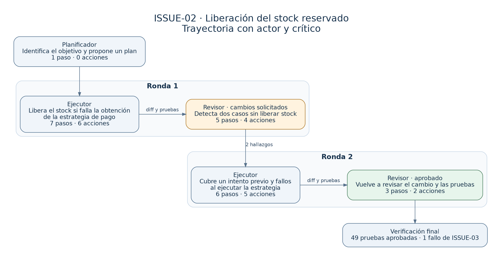

# E7. Observación de las trayectorias

## Métricas de los tres issues

Las métricas se tomaron de los JSONL de `trazas/` y, cuando existe, del `resumen.json` del orquestador. La observación usa las ejecuciones registradas por el equipo.

| Issue y variante | Pasos | Rondas | Acciones | Herramientas ejecutadas (llamadas) | Decisiones rechazadas por el contrato | Acciones bloqueadas por política | Contexto final (caracteres) |
|---|---:|---:|---:|---|---:|---:|---:|
| ISSUE-01 · agente único (E2) | 7 | 1 | 6 | `leer_archivo` ×3, `editar_archivo` ×1, `ejecutar_pruebas` ×1 | 0 | 1 (`ver_cambios`) | Sin medición |
| ISSUE-02 · agente único (E5) | 7 | 1 | 6 | `leer_archivo` ×2, `ejecutar_pruebas` ×2, `buscar` ×1, `editar_archivo` ×1 | 0 | 0 | 7 506 |
| ISSUE-02 · actor-crítico (E5) | 22 | 2 | 17 | `leer_archivo` ×5, `ejecutar_pruebas` ×5, `editar_archivo` ×3, `ver_cambios` ×2, `buscar` ×1, `anotar` ×1 | 0 | 0 | 40 250 |
| ISSUE-03 · agente único con mapa y notas (E4) | 14 | 1 | 13 | `leer_archivo` ×1, `ejecutar_pruebas` ×2, `mapa_repo` ×1, `anotar` ×2, `buscar` ×1, `editar_archivo` ×5, `leer_notas` ×1 | 0 | 0 | 26 645 |

Un paso es una decisión registrada, incluida la respuesta final. Las acciones incluyen intentos bloqueados y excluyen la respuesta final. Las llamadas de la columna de herramientas son las que llegaron a ejecutarse, aunque la herramienta haya devuelto un error. Para actor-crítico se suman los pasos y el contexto del planificador, el ejecutor y el revisor en sus respectivas ejecuciones. El planificador cuenta como un paso y cero acciones. En las variantes con un solo agente, una ronda equivale a una ejecución.

El contexto se mide como la longitud del historial serializado en JSON, en caracteres. La traza histórica de ISSUE-01 recortó las observaciones y no guardó ese total. Por eso figura como «Sin medición». El valor `0` indicaría un historial vacío y sería incorrecto.

### Evidencia y lectura por issue

- **ISSUE-01, cobros duplicados.** La [traza original](trazas/ejecutor.jsonl) muestra que el agente editó `servicio.py` en el paso 4. En el paso 5, pytest se detuvo durante la colección con tres errores de importación (`fitness` y `jsonschema`). En el paso 6, la política bloqueó `ver_cambios`. El agente declaró resuelta la tarea en el paso 7. La traza confirma la edición y el bloqueo, mientras que la corrección quedó sin verificación en esa ejecución.
- **ISSUE-02, liberación de stock.** El [agente único](trazas/issue02_unico/resumen.json) cubrió el error al obtener la estrategia de pago. En la [primera revisión](trazas/issue02_multi/revisor.jsonl) se identificaron otros dos caminos que retenían el stock: un intento de cobro previo y una excepción al ejecutar la estrategia. La [segunda revisión](trazas/issue02_multi/revisor_r2.jsonl) aprobó la corrección. El [resumen de actor-crítico](trazas/issue02_multi/resumen.json) guarda 49 pruebas aprobadas y un fallo correspondiente a ISSUE-03. Las pruebas específicas para los dos hallazgos quedaron como tarea del equipo.
- **ISSUE-03, precisión de importes.** La [traza con mapa y notas](trazas/issue03_unico/ejecutor.jsonl) registra la conversión del importe a `Decimal` y el guardado como `TEXT` en SQLite. Según el [resumen final](trazas/issue03_unico/resumen.json), pasaron 49 pruebas y falló la correspondiente a ISSUE-02. Frente a la [variante sin mapa ni notas](trazas/issue03_unico_base/resumen.json), el contexto subió de 18 993 a 26 645 caracteres (+40,3 %) y los pasos de 12 a 14. El mapa permitió registrar un pendiente: el puerto y el adaptador de pago aún declaran `monto: float`.

## Diagrama de una trayectoria

*Figura. Trayectoria del ISSUE-02 en dos rondas. En la primera, el revisor pidió cambios. En la segunda, aprobó la corrección del issue.*

El diagrama resume las cinco ejecuciones del [resumen](trazas/issue02_multi/resumen.json). El [diagrama Mermaid detallado](trazas/issue02_multi/trayectoria.mmd) conserva las llamadas a herramientas. La [fuente del resumen visual](trazas/issue02_multi/trayectoria-e7.dot) se puede renderizar desde la raíz mediante `dot -Tpng -Gdpi=160 agentes/trazas/issue02_multi/trayectoria-e7.dot -o agentes/trazas/issue02_multi/trayectoria-e7.png`.
