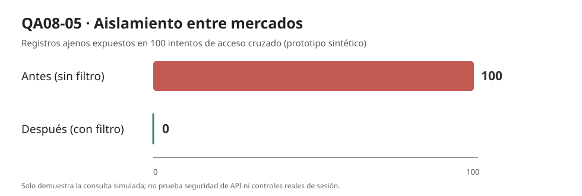

# E2. Iteración 1 de ADD con evidencia — San Camilo en Línea

**Escenario principal:** QA08-05 · **Importancia/dificultad:** **(H,H)** · **Atributo:** seguridad / aislamiento entre mercados  
**Base:** `docs/architecture/utilidad/escenarios.md` (E1), `drivers.md` y ADR-001 (Lab 04), modelo C4 (Lab 06), patrones de Lab 07.  
**Crecimiento previsto:** Mercado San Camilo + Altiplano + Río Seco, cada uno con comerciantes y reglas propias.

## 1. Objetivo y escenario priorizado

Se escogió **QA08-05** por su prioridad (H,H), compartida con QA08-04 y QA08-07, y por su relación directa con el crecimiento del caso: tres mercados no deben revelar pedidos entre sí. Es el **primer escenario elegido entre los empatados**, no el único (H,H).

Escenario en seis partes (tomado de E1):

| Parte | Definición |
|---|---|
| Fuente | Comerciante autenticado de uno de los tres mercados |
| Estímulo | Intenta consultar el identificador de un pedido de otro mercado |
| Entorno | 100 intentos cruzados entre San Camilo, Altiplano y Río Seco |
| Artefacto | API y repositorio del módulo Pedidos |
| Respuesta esperada | No entregar datos de pedidos pertenecientes a otro mercado |
| **Medida** | **0 registros ajenos expuestos en 100 intentos** |

El objetivo definido en el árbol **no es una medida de latencia**; por tanto, la evidencia del E2 utiliza **registros ajenos expuestos**, exactamente la misma magnitud que QA08-05.

## 2. Elemento refinado y conceptos de diseño

**Elemento refinado:** límite de autorización por mercado en el servicio y el repositorio de pedidos del monolito modular, sin crear microservicios.

**Prompt IA 2 utilizado:** ver [`prompt-ia2.md`](prompt-ia2.md), que considera ADR-001, presupuesto reducido, equipo de tres y el crecimiento a tres mercados.

| Concepto | Mejora | Costo, limitación o trade-off | Decisión |
|---|---|---|---|
| **A. Control por `mercado_id` en repositorio y API** | Una consulta queda restringida al mercado autenticado; un mismo esquema de datos admite tres mercados | Cada operación de lectura/escritura debe aplicar el contexto; riesgo si alguien omite un filtro | **Elegido como primera táctica comprobable** |
| **B. PostgreSQL Row-Level Security (RLS)** | Defensa adicional a nivel de base de datos contra consultas que omiten filtros | Requiere confirmar PostgreSQL, preparar políticas, controlar roles/conexiones y probarlas | **Pendiente para posible refuerzo** |
| **C. Una base de datos por mercado** | Aísla físicamente los registros de cada mercado | Más bases, migraciones, respaldos y costo de operación para equipo pequeño | **Rechazado para MVP** |
| **D. Filtrar solo en la interfaz PWA** | Menor esfuerzo aparente para mostrar pedidos de un mercado | No impide que la API entregue registros ajenos; el usuario puede inspeccionar respuestas | **Rechazado por no cumplir seguridad** |

**Decisión:** conservar el estilo **monolito modular** y comenzar por la regla de consulta `WHERE id = ? AND mercado_id = ?`, con `mercado_id` derivado **del contexto de sesión confiable**, no del valor arbitrario enviado por el usuario. El prototipo prueba exclusivamente el repositorio. La aplicación real deberá llevar este control a todas las rutas y operaciones y considerar RLS como defensa en profundidad cuando se confirme el motor de base de datos.

## 3. Evidencia cuantitativa antes y después

Se creó `fitness/aislamiento.py`, un prototipo mínimo reproducible con SQLite en memoria para **medir el mismo escenario de E1**. No hace llamadas a servicios reales.

### Supuestos de la prueba

1. **Mercados simulados:** San Camilo, Altiplano y Río Seco.
2. **Datos:** 12 pedidos ficticios (4 por mercado), identificadores de prueba y ninguna información personal.
3. **Carga de seguridad:** 100 intentos de lectura cruzada entre mercados (el solicitante siempre es de un mercado diferente del dueño del pedido). Selección pseudoaleatoria reproducible con **semilla 2026**.
4. **Antes:** consulta deliberadamente vulnerable `SELECT ... WHERE id = ?`, sin filtro por mercado. Es **una línea base sintética ilustrativa**, no una auditoría de la versión real del repositorio.
5. **Después:** consulta `SELECT ... WHERE id = ? AND mercado_id = ?`, tomando `mercado_id` de una sesión autenticada **simulada**.
6. **Control positivo:** 12 accesos a pedidos del propio mercado para asegurar que el filtro no niegue todas las consultas.
7. **Condiciones no medidas:** no hay tasa de llegada (req/s), tiempos de servicio ni probabilidad de fallo porque se optó por un **prototipo de autorización**, una de las dos formas de evidencia admitidas en E2. No se simulan HTTPS, autenticación real, ORM ni RLS de PostgreSQL.

### Tabla de resultados observados

| Medida del escenario QA08-05 | Antes: sin filtro | Después: con filtro | Meta E1 |
|---|---:|---:|---:|
| Accesos cruzados simulados | 100 | 100 | 100 |
| **Registros ajenos expuestos** | **100** | **0** | **0** |
| Porcentaje de intentos que exponen registros | 100 % | 0 % | 0 % |
| Accesos legítimos a pedidos propios admitidos | — | **12 de 12** | No bloquear consultas propias |

**Resultado del prototipo:** QA08-05 se cumple para los **100 intentos simulados**: se pasó de 100 registros ajenos expuestos en la línea base artificial a **0 tras el filtro**. Adicionalmente, 12 de 12 lecturas legítimas siguieron funcionando.



**Evidencia reproducible:** `resultados-aislamiento.json` (resumen), `intentos-aislamiento.csv` (100 casos), `aislamiento.svg` y `aislamiento.png` (gráfico), `tests/test_lab08_e2_aislamiento.py` (pruebas unitarias).

**Cómo repetir desde la raíz del repositorio:**

```bash
python -m fitness.aislamiento --intentos 100 --semilla 2026
python -m pytest -v tests/test_lab08_e2_aislamiento.py
```

## 4. Verificación y decisión al finalizar la iteración

| Pregunta ADD | Respuesta |
|---|---|
| ¿Se cumple la medida QA08-05? | **Sí, en el prototipo**: 0 accesos indebidos expuestos en 100 intentos cruzados. |
| ¿Qué táctica se implementó? | Consulta restringida por `mercado_id` en el repositorio de prueba. |
| ¿Qué se conserva? | El monolito modular del ADR-001 y la posibilidad de incorporar más mercados mediante configuración y datos. |
| ¿Qué se rechazó? | Base de datos independiente por mercado (costo operativo) y filtro exclusivo de frontend (inseguro). |
| ¿Qué falta antes de afirmar seguridad real? | Integración con autenticación/identidad del mercado, control en todas las rutas/operaciones, pruebas contra API real, auditoría de permisos y posible RLS si se adopta PostgreSQL. |

### Trade-off y riesgos residuales para E3 (ATAM-lite)

- **Punto de sensibilidad:** la confidencialidad depende de aplicar `mercado_id` desde un contexto de autenticación confiable **en todas** las consultas; un endpoint omitido puede volver a exponer datos.
- **Trade-off:** el filtrado añade condiciones a consultas y a pruebas, a cambio de proteger el aislamiento sin introducir tres bases distintas.
- **Riesgo:** si el mercado se toma de un parámetro controlado por el cliente, un comerciante podría suplantar otro contexto. Se debe obtener del token/sesión validada.
- **No riesgo en el prototipo:** las consultas legítimas siguieron funcionando (12/12), aunque esto no es evidencia suficiente para producción.

**Conclusión:** se recomienda la táctica A para el primer refinamiento y considerar RLS posteriormente. El experimento **no certifica** que el código actual de San Camilo en Línea ya implemente aislamiento entre mercados.
