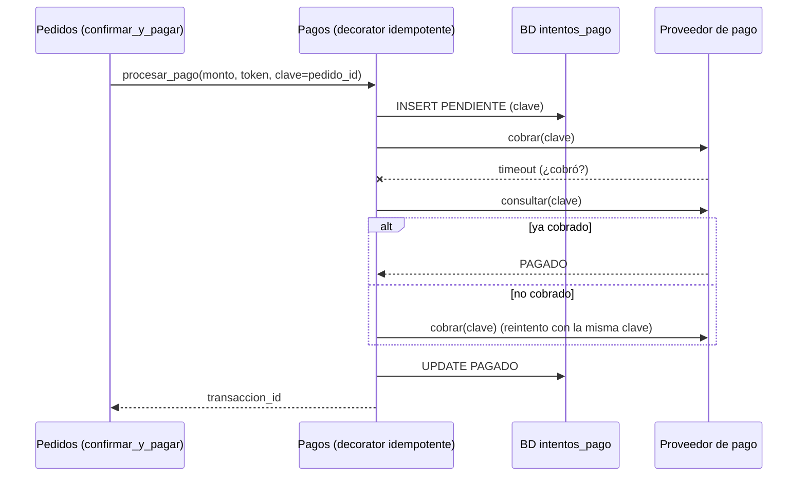
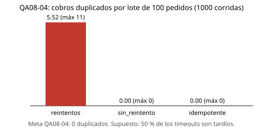

# E4. Iteración 2 de ADD — Cobros sin duplicados (QA08-04)

**Escenario:** QA08-04 · **Importancia/dificultad:** **(H,H)** · **Atributo:** disponibilidad  
**Base:** `utilidad/escenarios.md` (E1), `iteracion-1.md` (E2), ADR-001, ADR-003 y ADR-005, `src/despues/servicio.py` (Lab 07).  
**Decisión registrada en:** [ADR-007](../adr/007-cobros-idempotentes.md).

## Paso 1. Revisar las entradas

- Crecimiento del caso 7: tres mercados (San Camilo, Altiplano y Río Seco) cobran por el mismo módulo Pagos.
- R-06: Yape y WhatsApp son externos y pueden fallar. ADR-003 ya separa las notificaciones del pago.
- Código actual: `confirmar_y_pagar()` reintenta ante `ConnectionError` **sin clave de idempotencia** (`src/despues/servicio.py`, paso 4). Si el proveedor cobró y solo se perdió la respuesta, el reintento cobra otra vez.
- La iteración 1 resolvió QA08-05 (seguridad). Esta iteración atiende **disponibilidad**, como pide E4.

## Paso 2. Objetivo de la iteración

Escenario de E1, sin cambios:

| Parte | Definición |
|---|---|
| Fuente | Proveedor de pago |
| Estímulo | Responde con timeout en 10 de 100 intentos |
| Entorno | Lote simulado de 100 pedidos |
| Artefacto | Servicio de pagos |
| Respuesta | Conserva un resultado verificable sin duplicar cargos |
| **Medida** | **0 cobros duplicados entre 100 intentos** |

Lo elegimos porque es (H,H), distinto de QA08-05, y porque un cobro doble afecta directamente al cliente y al comerciante.

## Paso 3. Elemento a refinar

Componente **Pagos** de la API (contenedor "Aplicación web / API") y su relación con la base de datos. Se refina el flujo `confirmar_y_pagar()` → `PuertoPago.procesar_pago()`.

## Paso 4. Conceptos de diseño candidatos

| Concepto | Qué mejora | Qué cuesta o empeora | Decisión |
|---|---|---|---|
| **A. Reintentos sin clave** (lo actual) | Recupera timeouts transitorios | Cada timeout tardío se convierte en un cargo doble | **Línea base** |
| **B. Sin reintento automático** | Nunca duplica | Pierde la venta y deja cobros huérfanos: el cliente pagó y el pedido figura como fallido | **Rechazado** |
| **C. Clave de idempotencia + registro PENDIENTE (outbox) + consulta antes de reintentar** | El proveedor no repite el cargo; el pedido queda en un estado verificable | Una tabla más (`intentos_pago`), un estado PENDIENTE y una tarea de conciliación | **Elegido** |
| **D. Circuit breaker** (ejemplo AgroConecta) | Protege al proveedor caído y falla rápido | No distingue un timeout tardío de uno temprano: no evita el duplicado | **Rechazado para este escenario** |
| **E. Transacción distribuida (2PC) con el proveedor** | Atomicidad pago–pedido | El proveedor externo no participa en 2PC; excede R-01 y R-03 | **Rechazado** |

Tácticas de disponibilidad usadas en C: **reintento** acotado (3 intentos), **detección** (consulta del estado del cobro) y **recuperación** por conciliación de pendientes.

## Paso 5. Instanciar elementos y responsabilidades

| Elemento | Responsabilidad | Interfaz |
|---|---|---|
| Tabla `intentos_pago` | Guarda `pedido_id`, clave, estado (PENDIENTE, PAGADO, FALLIDO) **antes** de llamar al proveedor | SQL (PostgreSQL, ADR-001) |
| `PuertoPago` | Se amplía con la clave: `procesar_pago(monto, token, clave)` y `consultar(clave)` | Puerto del Lab 07 (ADR-005) |
| Decorator de idempotencia sobre `PuertoPago` | Reintenta con la misma clave y consulta tras cada timeout | Mismo `PuertoPago` (no cambia el servicio) |
| Worker (Celery) | Concilia cada 5 min los intentos que siguen en PENDIENTE | Tarea periódica |

## Paso 6. Vista y decisiones



## Paso 7. Evidencia y análisis

Prototipo: `fitness/cobros.py` (Monte Carlo, sin servicios reales).

### Supuestos

1. **10 de 100** primeros intentos reciben timeout (posiciones al azar, semilla 2026).
2. Un timeout es **tardío** (el proveedor cobró, la respuesta se perdió) con probabilidad **0,5**. Es el supuesto más sensible; abajo se varía de 0 a 1.
3. Los reintentos fallan con probabilidad 0,10. Máximo 3 intentos por pedido, como `max_reintentos`.
4. El proveedor acepta una clave de idempotencia y permite consultar un cobro por esa clave.
5. No se modelan latencias, caídas totales ni el worker real de conciliación.

### Resultados (lote de 100 pedidos, semilla 2026)

| Táctica | Pedidos confirmados | **Cobros duplicados** | Cobros huérfanos | Pendientes de conciliar |
|---|---:|---:|---:|---:|
| A. Reintentos sin clave (actual) | 100 | **8** | 0 | 0 |
| B. Sin reintento | 90 | 0 | 6 | 0 |
| **C. Idempotente** | **100** | **0** | **0** | **0** |

### Monte Carlo (1000 corridas, semillas 0–999)

| Táctica | Duplicados promedio | p95 | Máximo | Corridas con duplicados |
|---|---:|---:|---:|---:|
| A. Reintentos sin clave | 5,52 | 8 | 11 | 1000 / 1000 |
| B. Sin reintento | 0 | 0 | 0 | 0 (pero 4,96 huérfanos en promedio) |
| **C. Idempotente** | **0** | **0** | **0** | **0 / 1000** |



### Sensibilidad al supuesto 2 (200 corridas por punto)

| Fracción de timeouts tardíos | 0 | 0,25 | 0,5 | 0,75 | 1 |
|---|---:|---:|---:|---:|---:|
| A. Duplicados promedio | 0 | 2,82 | 5,52 | 8,29 | 11,07 |
| C. Duplicados promedio | 0 | 0 | 0 | 0 | 0 |

Con la táctica C el resultado no depende de este supuesto. Con A, los duplicados crecen en línea con la fracción de timeouts tardíos.

**Evidencia reproducible:** `resultados-cobros.json`, `cobros.svg` y `tests/test_fitness.py` (FF-05).

```bash
python -m fitness.cobros --pedidos 100 --timeouts 10 --semilla 2026
```

### ¿Se cumple QA08-04?

**Sí, en la simulación:** 0 cobros duplicados en 100 intentos y en 1000 corridas, sin perder ventas (100/100 confirmados).

| Pregunta ADD | Respuesta |
|---|---|
| Trade-off aceptado | Más estado (tabla `intentos_pago`, estado PENDIENTE) y una tarea de conciliación, a cambio de no cobrar dos veces ni perder la venta. |
| Punto de sensibilidad | El supuesto 4: si el proveedor no acepta clave ni consulta por referencia, C se reduce a B (sin duplicados, pero con huérfanos). |
| Qué se conserva | Monolito modular (ADR-001); el servicio sigue usando solo `PuertoPago` (ADR-005). |
| Qué falta para producción | Confirmar la API del proveedor (clave y consulta), migración de `intentos_pago` y la tarea periódica en el worker. |
