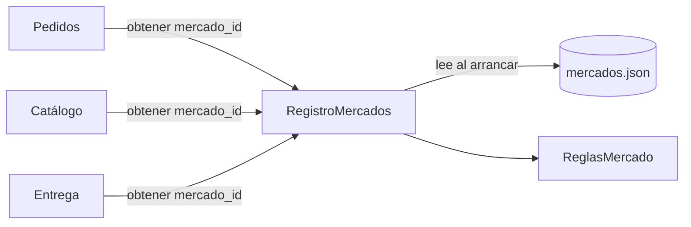

# E4. Iteración 3 de ADD — Alta de mercados por configuración (QA08-07)

**Escenario:** QA08-07 · **Importancia/dificultad:** **(H,H)** · **Atributo:** modificabilidad  
**También atiende:** QA08-08 (cambiar una regla de Río Seco sin afectar a los otros mercados).  
**Base:** `utilidad/escenarios.md` (E1), `iteracion-1.md`, `iteracion-2.md`, ADR-001 y ADR-005.  
**Decisión registrada en:** [ADR-008](../adr/008-reglas-de-mercado-por-configuracion.md).

## Paso 1. Revisar las entradas

- El escenario de crecimiento del caso 7 es justamente este: Altiplano y Río Seco llegan **con sus propias reglas y comerciantes**.
- La modificabilidad es un atributo crítico del caso (tabla 11 de la guía). QA08-07 es (H,H).
- La iteración 1 ya agregó `mercado_id` a los datos (QA08-05). Falta decidir **dónde viven las reglas** de cada mercado.
- Restricciones: 1 mes (R-01), 3 desarrolladores (R-02), presupuesto bajo (R-03), monolito modular (ADR-001).

## Paso 2. Objetivo de la iteración

| Parte | Definición |
|---|---|
| Fuente | Equipo de desarrollo |
| Estímulo | Incorpora Altiplano y Río Seco con reglas comerciales propias |
| Entorno | Monolito modular; equipo de 3; plazo de 1 mes |
| Artefacto | Módulos Catálogo, Pedidos y configuración |
| Respuesta | Incorpora mercados mediante configuración o extensión de reglas |
| **Medida** | **≤ 2 días de trabajo por mercado; ≤ 2 módulos existentes modificados** |

## Paso 3. Elemento a refinar

Las reglas comerciales que hoy no tienen dueño: monto mínimo, horario de atención y delivery (permitido y costo). Las consultan Catálogo, Pedidos y Entrega.

## Paso 4. Conceptos de diseño candidatos

| Concepto | Qué mejora | Qué cuesta o empeora | Decisión |
|---|---|---|---|
| **A. `if mercado == ...` en cada módulo** | Lo más rápido para el primer mercado | Cada mercado nuevo toca Catálogo, Pedidos y Entrega; las reglas quedan dispersas | **Línea base (rechazado)** |
| **B. Módulo `mercados` con reglas como datos + registro** | Un mercado nuevo es una entrada de configuración; los demás módulos piden `obtener(mercado_id)` | Solo cubre reglas que se expresan como parámetros; una regla con lógica propia exigirá una Strategy | **Elegido** |
| **C. Motor de reglas genérico (DSL)** | Reglas arbitrarias sin desplegar | Aprender y probar un motor nuevo excede R-01 y R-02; hoy las reglas son 5 parámetros | **Rechazado** |
| **D. Una instancia desplegada por mercado** | Aislamiento total de reglas | Triplica despliegues, bases y respaldos; contradice ADR-001 y R-03 | **Rechazado** |

Tácticas de modificabilidad: **aumentar la cohesión** (todas las reglas en un módulo), **reducir el acoplamiento** (un solo punto de entrada, `RegistroMercados`) y **diferir el enlace** (las reglas se leen de configuración al arrancar).

## Paso 5. Instanciar elementos y responsabilidades

Implementado en `src/mercados/`:

| Elemento | Responsabilidad |
|---|---|
| `reglas.py` · `ReglasMercado` | Valor inmutable con las reglas de un mercado: `validar_pedido()` y `costo_envio()` |
| `registro.py` · `RegistroMercados` | Carga `mercados.json` y responde `obtener(mercado_id)`; rechaza mercados duplicados o desconocidos |
| `mercados.json` | Una entrada por mercado (San Camilo, Altiplano y Río Seco). Las reglas son ilustrativas |

Regla de dependencia: `mercados` no importa a Pedidos, Pagos ni al Lab 07 (FF-03 en `.importlinter`). Ningún módulo fuera de `src/mercados` escribe un identificador de mercado como literal (FF-06).

## Paso 6. Vista y decisiones



## Paso 7. Evidencia y análisis

Experimento: `fitness/alta_mercados.py`. Sobre **copias temporales** agrega un cuarto mercado (`MERCADO_PRUEBA`) con cada alternativa, cuenta los archivos y las líneas que cambian con `difflib` e importa el resultado para comprobar que el mercado nuevo funciona.

### Supuestos

1. La alternativa A es una **línea base sintética** (`fitness/prototipo_condicionales/`): tres funciones con `if/elif`, una por módulo. No es código de producción.
2. Las reglas de cada mercado son ilustrativas (`mercados.json`); no fueron acordadas con los mercados.
3. Los días de trabajo **no se miden**: el experimento mide módulos y líneas, que son la parte objetiva de la medida.

### Resultados

| Medida (alta de 1 mercado) | A. Condicionales | **B. Configuración** | Meta QA08-07 |
|---|---:|---:|---:|
| **Módulos .py existentes modificados** | 3 (catálogo, pedidos, entrega) | **0** | ≤ 2 |
| Archivos modificados | 3 | 1 (`mercados.json`) | — |
| Líneas cambiadas | 6 | 9 | — |
| ¿El mercado nuevo funciona tras el cambio? | Sí | Sí | — |
| Literales de mercado fuera de `src/mercados` | 3 módulos | **0** | — |

**Lectura crítica:** B no reduce las líneas (9 frente a 6); reduce **dónde** se cambia. Con A, cada mercado toca 3 módulos y supera la meta de ≤ 2; con 3 reglas más por mercado, la diferencia crece. Con B, el cambio queda en un archivo de datos que puede revisar alguien que no programa.

QA08-08 se comprueba en `tests/test_fitness.py` (FF-07): al cambiar el monto mínimo de Río Seco en una copia de la configuración, las reglas de San Camilo y Altiplano no cambian.

```bash
python -m fitness.alta_mercados
python -m pytest -v tests/test_fitness.py
```

**Evidencia reproducible:** `resultados-alta-mercados.json`, `fitness/alta_mercados.py`, `src/mercados/` y las pruebas FF-06 y FF-07.

### ¿Se cumple QA08-07?

**Sí, en la medida de módulos:** 0 módulos existentes modificados (meta ≤ 2). Para los días de trabajo solo tenemos una estimación: 1 entrada de 9 líneas más sus pruebas cabe en un día, pero no lo medimos.

| Pregunta ADD | Respuesta |
|---|---|
| Trade-off aceptado | Las reglas que no son parámetros (por ejemplo, un descuento por volumen solo en Río Seco) necesitarán una Strategy registrada; por ahora no la creamos (YAGNI). |
| Punto de sensibilidad | Que el equipo respete el registro: un `if mercado == "ALTIPLANO"` en Pedidos rompe la táctica. FF-06 lo detecta en la CI. |
| Qué se conserva | Monolito modular (ADR-001), Strategy y Factory del Lab 07 (ADR-005) y el `mercado_id` de la iteración 1 (ADR-006). |
