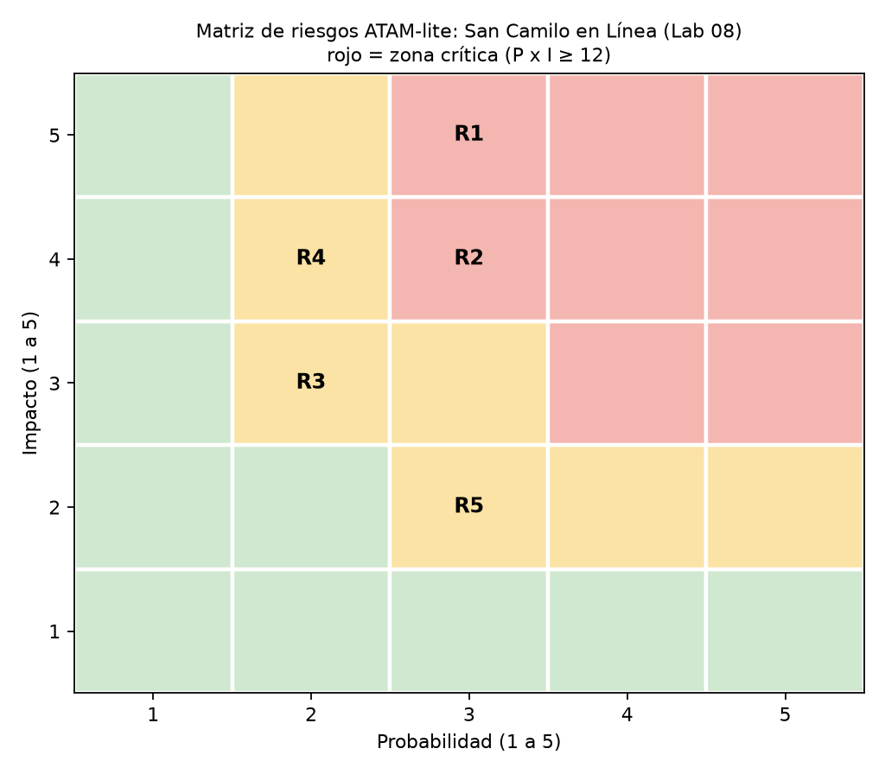

# ATAM-lite — San Camilo en Línea (Lab 08)

Escenario de crecimiento: se suman los mercados Altiplano y Río Seco, cada uno con sus reglas y comerciantes.
Evidencia: iteraciones 1 a 3 (`add/`), ADR-006 a ADR-008 y fitness functions FF-01 a FF-07.

## 1. Hallazgos propios (de las iteraciones de ADD)

| Tipo | Hallazgo | Evidencia | Respuesta del equipo |
|------|----------|-----------|----------------------|
| Sensibilidad S1 | QA08-04 depende de que el proveedor acepte la clave de idempotencia y la consulta por referencia | Monte Carlo: con la táctica actual los duplicados suben de 0 a 11,07 en promedio al aumentar los timeouts tardíos (0 a 100 %); con la elegida se mantienen en 0 | Se validará con el sandbox del proveedor antes de producción |
| Sensibilidad S2 | QA08-07 depende de que nadie escriba un `if` por mercado fuera de `src/mercados` | `fitness/alta_mercados.py`: 3 módulos modificados con condicionales, 0 con configuración | Vigilado por FF-06 en cada Pull Request |
| Trade-off T1 | Aislamiento de datos (QA08-05) frente a una condición más por consulta; si un endpoint omite el filtro `mercado_id`, expone datos | Prototipo: 100 → 0 registros ajenos en 100 intentos (ADR-006) | Aceptado; FF-04 lo vigila y RLS queda como segunda capa pendiente |
| Trade-off T2 | Cobros sin duplicados (QA08-04) frente a más piezas: tabla `intentos_pago`, estado PENDIENTE y conciliación (consistencia eventual) | Monte Carlo: 8 → 0 duplicados, 100 de 100 pedidos confirmados (ADR-007) | Aceptado |
| Trade-off T3 | Modificabilidad (QA08-07) frente a rigidez: una regla que no sea un parámetro exige una Strategy; cambiar una regla exige reiniciar la app | difflib: 0 módulos modificados, pero 9 líneas frente a 6 (ADR-008) | Aceptado |

## 2. Hallazgos recibidos (evaluación cruzada, E3)

| Tipo | Hallazgo recibido | ¿Aceptado o refutado? | Respuesta con evidencia |
|------|-------------------|-----------------------|-------------------------|
| Sensibilidad | [copiar del issue recibido] | [aceptado / refutado] | [evidencia] |
| Trade-off | [copiar] | | |
| Riesgo | [copiar, con probabilidad e impacto] | | |
| Riesgo | [copiar, con probabilidad e impacto] | | |
| No riesgo | [copiar] | | |

## 3. Riesgos y matriz de probabilidad e impacto

| ID | Riesgo | Prob. (1-5) | Impacto (1-5) | P×I | Zona |
|----|--------|:-----------:|:-------------:|:---:|------|
| R1 | Un endpoint omite el filtro `mercado_id` y expone pedidos de otro mercado | 3 | 5 | 15 | Crítica |
| R2 | El proveedor no soporta clave de idempotencia ni consulta por referencia | 3 | 4 | 12 | Crítica |
| R3 | La conciliación del worker se atrasa y quedan cobros en PENDIENTE | 2 | 3 | 6 | Media |
| R4 | Un solo VPS es punto único de falla | 2 | 4 | 8 | Media |
| R5 | Una regla de mercado no se puede expresar como parámetro | 3 | 2 | 6 | Media |

## 4. No riesgos

| ID | Decisión evaluada | Evidencia |
|----|-------------------|-----------|
| NR1 | El filtro `mercado_id` aísla los pedidos en el prototipo | 0 registros ajenos en 100 intentos; 12 de 12 lecturas propias (FF-04) |
| NR2 | El cobro idempotente evita duplicados | 0 duplicados en 1000 corridas; 100 de 100 pedidos confirmados (FF-05) |
| NR3 | Un mercado nuevo no toca módulos de negocio | 0 módulos `.py` modificados (FF-06) |

## 5. Mitigaciones y riesgos aceptados

| Riesgo | Zona | Decisión | Mitigación o razón |
|--------|------|----------|--------------------|
| R1 Endpoint sin filtro `mercado_id` | Crítica | Mitigar | FF-04 falla en el Pull Request si hay datos ajenos; revisar que toda consulta use el filtro de la sesión; RLS de PostgreSQL como segunda capa (pendiente de decidir) |
| R2 Proveedor sin idempotencia | Crítica | Mitigar | Probar la clave de idempotencia y la consulta por referencia en el sandbox del proveedor antes de producción; si no la soporta, el cobro queda PENDIENTE y se concilia a mano cada día |
| R3 Conciliación atrasada | Media | Aceptar | Se revisa a diario el número de cobros PENDIENTE; con un volumen de 100 pedidos el impacto es bajo |
| R4 VPS único | Media | Aceptar | Es el estilo del ADR-001, el plazo es de 1 mes y el presupuesto es bajo; respaldo diario de la base de datos |
| R5 Regla que no es un parámetro | Media | Aceptar | Se resuelve con una Strategy registrada (trade-off T3, ADR-008) |