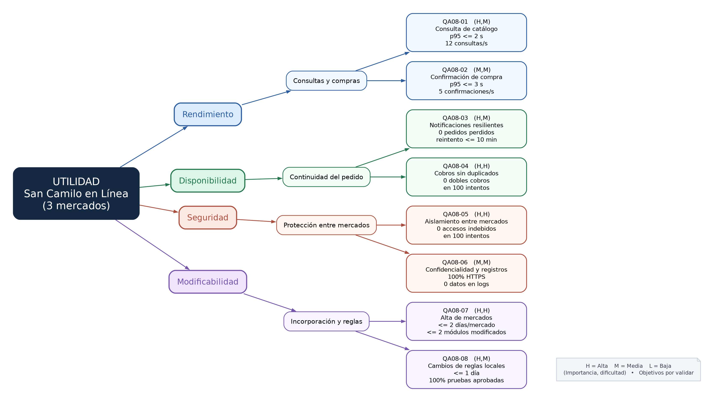

# E1. Árbol de utilidad — San Camilo en Línea

## Fuentes y alcance

- **Drivers de Lab 04:** QA-01 (publicar producto en ≤ 3 toques), QA-02 (catálogo con p95 ≤ 2 s), QA-03 (0 pedidos perdidos ante caída de WhatsApp; reintento ≤ 10 min), R-01 (1 mes), R-02 (equipo de 3), R-03 (presupuesto bajo), R-04 (datos personales), R-06 (integraciones externas).
- **ADR-001:** monolito modular, con catálogo, pedidos, pagos, notificaciones y entrega; no se justifica migrar a microservicios solo por el crecimiento.
- **Escenario de crecimiento Lab 08, tabla 11 (caso 7):** incorporación de mercados Altiplano y Río Seco, cada uno con comerciantes y reglas propias.
- **Importante:** las metas adicionales y las cargas de prueba son hipótesis de diseño de este ejercicio, **no resultados de mediciones reales**. La carga de 12 consultas/s y de 5 confirmaciones/s es un supuesto de trabajo que deberá contrastarse con el equipo en E2.

## Escenarios de calidad de seis partes

Cada escenario especifica: **fuente**, **estímulo**, **entorno**, **artefacto**, **respuesta** y **medida**; H = alta, M = media, L = baja.

### QA08-01 — Rendimiento: Consulta de catálogo — (H,M)

- **Fuente:** Cliente.
- **Estímulo:** Consulta productos de un puesto en uno de los 3 mercados.
- **Entorno:** Hora punta; 12 consultas/s en total; conexión móvil.
- **Artefacto:** API de Catálogo.
- **Respuesta:** Devuelve productos filtrados por mercado y puesto.
- **Medida:** p95 <= 2 s.

### QA08-02 — Rendimiento: Confirmación de compra — (M,M)

- **Fuente:** Cliente.
- **Estímulo:** Confirma pedido con productos de 2 puestos del mismo mercado.
- **Entorno:** Operación normal; 5 confirmaciones/s.
- **Artefacto:** API de Pedidos.
- **Respuesta:** Registra el pedido y responde al cliente.
- **Medida:** p95 <= 3 s.

### QA08-03 — Disponibilidad: Notificaciones resilientes — (H,M)

- **Fuente:** Proveedor WhatsApp.
- **Estímulo:** No responde durante 30 minutos.
- **Entorno:** Pedidos confirmados durante la caída.
- **Artefacto:** Pedidos y notificaciones.
- **Respuesta:** Conserva pedidos y deja avisos pendientes para reintento.
- **Medida:** 0 pedidos perdidos; primer reintento <= 10 min.

### QA08-04 — Disponibilidad: Cobros sin duplicados — (H,H)

- **Fuente:** Proveedor de pago.
- **Estímulo:** Responde con timeout en 10 de 100 intentos.
- **Entorno:** Lote simulado de 100 pedidos.
- **Artefacto:** Servicio de pagos.
- **Respuesta:** Conserva resultado verificable sin duplicar cargos.
- **Medida:** 0 cobros duplicados entre 100 intentos.

### QA08-05 — Seguridad: Aislamiento entre mercados — (H,H)

- **Fuente:** Comerciante autenticado.
- **Estímulo:** Intenta consultar pedidos de otro mercado.
- **Entorno:** 100 intentos cruzados San Camilo/Altiplano/Río Seco.
- **Artefacto:** API y repositorio de pedidos.
- **Respuesta:** Deniega acceso a datos de mercado ajeno.
- **Medida:** 0 registros ajenos expuestos en 100 intentos.

### QA08-06 — Seguridad: Confidencialidad y registros — (M,M)

- **Fuente:** Cliente.
- **Estímulo:** Envía solicitudes que contienen identificadores y datos de contacto.
- **Entorno:** 100 peticiones de prueba a la API.
- **Artefacto:** Transporte HTTPS y registro de aplicación.
- **Respuesta:** Protege transporte y evita registrar datos sensibles.
- **Medida:** 100% peticiones por HTTPS; 0 datos sensibles en logs.

### QA08-07 — Modificabilidad: Alta de mercados — (H,H)

- **Fuente:** Equipo de desarrollo.
- **Estímulo:** Incorpora Altiplano y Río Seco con reglas comerciales propias.
- **Entorno:** Arquitectura monolítica modular; equipo de 3; plazo de 1 mes.
- **Artefacto:** Módulos Catálogo, Pedidos y configuración.
- **Respuesta:** Incorpora mercados mediante configuración/extensión de reglas.
- **Medida:** <= 2 días de trabajo por mercado; <= 2 módulos existentes modificados.

### QA08-08 — Modificabilidad: Cambios de reglas locales — (H,M)

- **Fuente:** Administrador de negocio.
- **Estímulo:** Modifica una regla comercial de Río Seco.
- **Entorno:** Sistema con 3 mercados en operación.
- **Artefacto:** Módulo de reglas de mercado.
- **Respuesta:** Aplica cambio sin alterar las reglas de los otros mercados.
- **Medida:** <= 1 día de trabajo; 100% pruebas existentes aprobadas.

## Prioridad y corrección de una sugerencia de IA

| Escenario | Atributo | Sugerencia IA (I,D) | Selección revisada | Motivo |
|---|---|---|---|---|
| QA08-01 | Rendimiento | (H,M) | **(H,M)** | Se mantiene el objetivo p95 del Lab 04 con mayor variedad de consultas. |
| QA08-02 | Rendimiento | (M,M) | **(M,M)** | Objetivo complementario de compra; estimación por comprobar. |
| QA08-03 | Disponibilidad | (H,M) | **(H,M)** | Mantener pedidos registrados ante WhatsApp caído ya era un driver. |
| QA08-04 | Disponibilidad | (H,H) | **(H,H)** | Las fallas del proveedor de pago pueden producir dobles cobros; reto alto. |
| QA08-05 | Seguridad | **(M,M)** | **(H,H)** | **Calificación corregida:** con tres mercados, la fuga cruzada de pedidos afectaría confidencialidad y confianza; aislar datos requiere controles persistentes y pruebas de autorización. |
| QA08-06 | Seguridad | (M,M) | **(M,M)** | Protección y registros necesitan verificación, pero no dependen directamente de reglas particulares de cada mercado. |
| QA08-07 | Modificabilidad | (H,H) | **(H,H)** | Incorporar mercados con reglas distintas exige extensiones sin acoplar módulos del monolito. |
| QA08-08 | Modificabilidad | (H,M) | **(H,M)** | El monolito modular permite encapsular reglas, pero todavía exige pruebas de regresión. |

**Atributos críticos del crecimiento:** modificabilidad y aislamiento de mercados (representado en seguridad). Ambos tienen al menos un escenario **(H,H)**.

## Sugerencia para la iteración E2

Se propone iniciar con **QA08-05 (aislamiento entre mercados)** o **QA08-07 (alta de mercados)**, según el objetivo acordado por el equipo. El primero admite pruebas cuantitativas reproducibles: 100 accesos cruzados y 0 registros ajenos expuestos; el segundo exige validar duración y número de módulos modificados. No afirmar que las metas se cumplieron hasta realizar las pruebas.

## Diagrama

